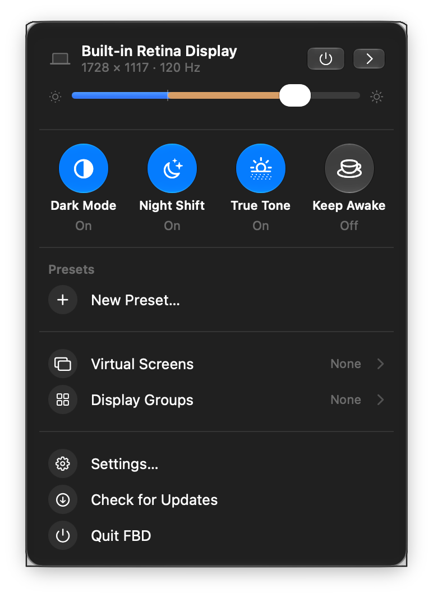

# FBD — Free Better Display

A free, MIT-licensed macOS menu-bar app for display control. Brightness,
contrast, volume, input switching, resolution and refresh rate, virtual
displays, HDR and XDR, full-screen software filters, screen rotation, EDID,
per-display automation, a command-line client and a local HTTP API — with no
Pro tier, no licensing and no telemetry.

**Status: beta.** Most of the surface is implemented and unit-tested; the
features that needed hardware to prove — DDC/CI on an external monitor, EDID,
the below-floor brightness blend and HiDPI smooth scaling — have now been
measured on real machines, and the paths that still have not say so. Apple
locks down private display APIs differently on every macOS release, so FBD
degrades gracefully — the feature turns off and the UI says why — instead of
guessing.

[](https://github.com/FisiFla/FBD/actions/workflows/ci.yml)



## Install

Releases are on the [GitHub Releases](https://github.com/FisiFla/FBD/releases)
page. The current asset is `FBD-unsigned.zip`: **not** signed and **not**
notarised, so Gatekeeper refuses it on first open. Either right-click
`FBD.app` → **Open** → **Open**, or clear the quarantine flag:

```sh
xattr -dr com.apple.quarantine /Applications/FBD.app
```

Signed, notarised builds are not published yet — they need a Developer ID
certificate ([#6](https://github.com/FisiFla/FBD/issues/6)).

Every unsigned update is a new binary as far as macOS is concerned: the first
launch asks for Screen Recording again, and the first request that reads the
API token asks for your login Keychain password — choose **Always Allow**. The
app stays responsive while that prompt is open (the Keychain read happens off
the main thread), but the API answers 401 until the password is entered.

## What it does

- **Displays** — brightness (Apple and DDC/CI), contrast, volume, mute, input
  source, resolution and refresh rate, rotation, ICC profiles, EDID export, a
  per-display page with protected properties, display groups with sync
  policies, and pointer crossing between misaligned screens.
- **Screens** — virtual displays, full-screen software filters (contrast,
  saturation, gamma, colour temperature, invert, sharpen, zoom, 3D LUT),
  picture-in-picture and streaming, HDR mode, XDR upscaling, Night Shift,
  True Tone and Dark Mode.
- **Behaviour** — per-display event automation (shell, URL or notification), a
  configurable on-screen HUD, Dock and menu-bar preferences, lock-dim, saved
  TV/AVR control over the network, and disconnects that can be remembered
  across reboots.
- **Surfaces** — the menu-bar panel, the Settings window, `fbdcli`, a local
  HTTP API and Shortcuts actions. They all drive the same controller, so they
  cannot drift apart.

## Requirements and permissions

macOS 13.2+ (Apple Silicon preferred — DDC needs native arm64); Xcode 15+ /
Swift 5.9+ to build from source.

Permissions are asked for one at a time, each only for the feature that needs
it. Nothing is granted automatically, and a feature whose permission is
missing stays off.

| Permission | Needed for |
|---|---|
| Screen Recording | software brightness boost (XDR fallback), full-screen filters, picture-in-picture, streaming |
| Accessibility | media-key interception (off by default) and the UI smoke test |
| Local Network | controlling TVs and AVRs over the network (LG, Samsung, Philips, Yamaha) |

## What works where

| Feature | macOS 13–15 | macOS 26 | macOS 27 |
|---|---|---|---|
| Apple brightness / resolution | ✅ | ✅ | ✅ live-verified |
| DDC/CI (external displays, Apple Silicon) | ✅ verified on an external monitor | ✅ same | ✅ same |
| Virtual displays | ⚠️ `CGVirtualDisplay`, unverified | ✅ `SLVirtualDisplay` | ✅ live-verified |
| XDR upscaling (native preset rewrite) | ✅ | ⚠️ write-protected → software boost | ⚠️ write-protected → software boost (the boost overlay is live-verified); preset switching ✅ |
| Night Shift / Dark Mode / True Tone / OSD / PiP / profiles | ✅ | ✅ | ✅ live-verified |
| Full-screen software filters | ✅ | ✅ | ✅ live-verified |
| EDID | ✅ external displays verified; the built-in panel exposes none | ✅ same | ✅ same |
| Below-floor brightness blend | ✅ needs Screen Recording; verified below an external monitor's own floor | ✅ same | ✅ same |
| HiDPI smooth scaling | ✅ the privileged write is verified on hardware | ✅ same | ✅ same |
| Remembered disconnects · docked built-in · ambient sync | ⚠️ implemented, not verified on hardware | ⚠️ same | ⚠️ same |

*Live-verified* means it was measured on a real machine, not merely
implemented; the evidence is in [`docs/PRIVATE_APIS.md`](docs/PRIVATE_APIS.md).
Two machines carry it: the built-in XDR panel of an M1 Max on macOS 27, and —
since 2026-10-28 — a second Apple Silicon Mac with an external monitor, which
verified DDC/CI, EDID, the below-floor blend and HiDPI smooth scaling. Those
rows are marked in every macOS column because the same code path serves all
three; one monitor is one monitor, so a display with unusual DDC quirks can
still surprise the transport. Screen rotation on an external display and the
three display-connection behaviours (remembered disconnects, the docked
built-in display, the ambient sync) are implemented but unverified.

Two safety notes. The built-in display is **not** disconnected on base-M3
MacBooks, where Apple repurposed the panel's connection for clamshell mode —
the disconnect is refused before any call is made. And DDC/CI does not work
under Rosetta.

## Build and run

```bash
make build        # debug, native arch
make test         # unit tests
make app          # release universal FBD.app → build/FBD.app
open build/FBD.app
```

## fbdcli

```bash
swift run fbdcli list                 # the displays
swift run fbdcli brightness 1 60      # set display 1 to 60 %
swift run fbdcli filter 1 1 0 1 1     # full-screen filter (contrast sat gamma temp)
swift run fbdcli rotate 3 90          # rotate an external display
swift run fbdcli hidpi 3 install      # scaled-mode ladder (macOS asks for an admin password)
swift run fbdcli gamma-floor 3 on 15  # reach the bottom of the slider in software
swift run fbdcli report               # detailed per-display report (for bug reports)
swift run fbdcli config show          # lock dim, keyboard target, groups, brightness model…
```

`fbdcli help` lists everything. Writes go through the running app's local HTTP
API (single driver, so the CLI never races the DDC bus); `--direct` forces
local execution. When an answer is lost the CLI says *the command may have
applied* and names the command that reads the state back — a write that was
not confirmed is not a failed write.

`fbdcli skill install claude` writes an agent-ready `SKILL.md` (the grammar,
the token model and the read-back contract) to `~/.claude/skills/fbd/`; `codex`
is also supported, and `--print` dumps it instead of writing it.

## HTTP API and URL scheme

The app can serve a JSON API on `127.0.0.1` only (`fbdcli http on <port>`,
default 8765, applied live). Every request carries the local API token, which
lives in the login Keychain and is never printed unless you ask for it:
`fbdcli auth-token --reveal`. `GET /api/health` is the only unauthenticated
endpoint.

`fbd://open` opens the settings panel and `fbd://close` closes it; the
`fbd://brightness/<displayID>/<value>` form exists and requires the token.

## Docs

- [Architecture](docs/ARCHITECTURE.md) · [Private APIs](docs/PRIVATE_APIS.md) ·
  [DDC audit](docs/ddc-equivalence.md) · [Roadmap](docs/ROADMAP.md) ·
  [Domain glossary](CONTEXT.md)
- [Contributing](CONTRIBUTING.md) · [Releasing](RELEASING.md) ·
  [Security](SECURITY.md) · [Acknowledgments](ACKNOWLEDGMENTS.md)
- [Changelog](CHANGELOG.md)

## License

MIT — see [LICENSE](LICENSE). FBD is an independent implementation; it is not
affiliated with BetterDisplay or its author.
